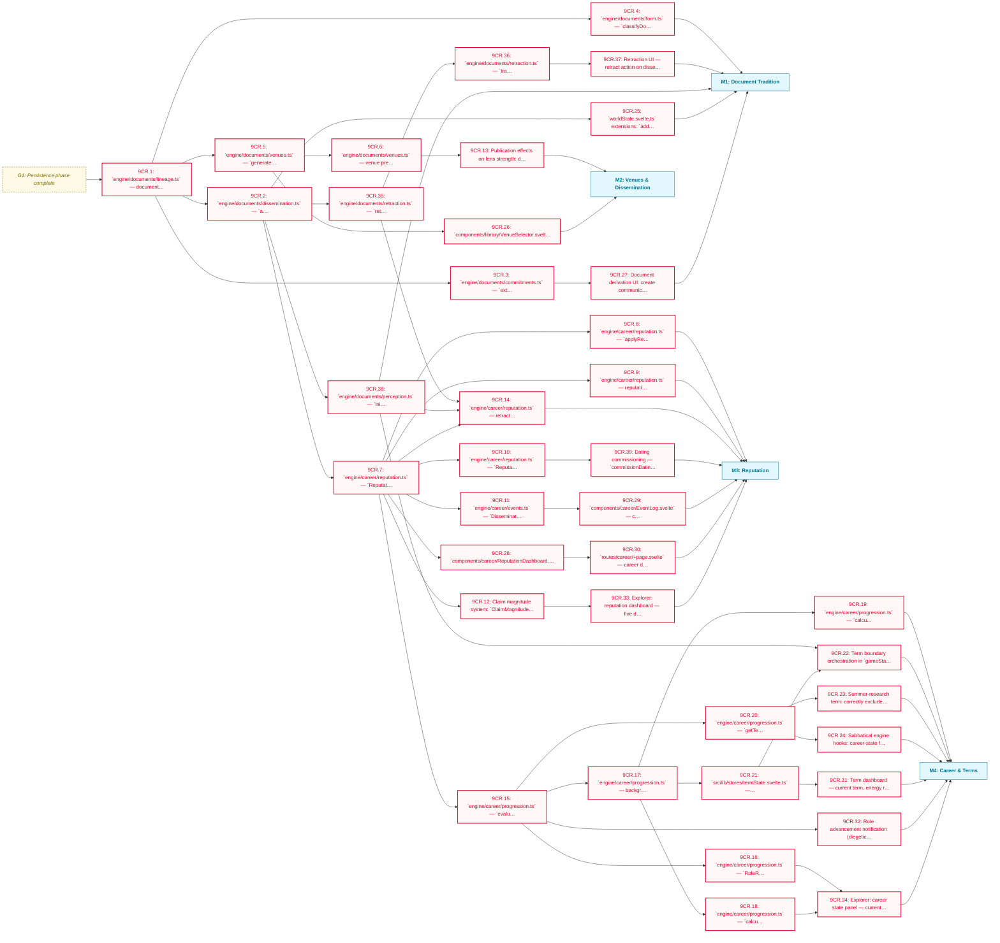

# Those Who Came Before: Career & Publication

**State:** planned. Stored as `archived` until the roadmap plugin gains a planned phase state
(goblin-scout 3.x); promote it once the phase before it is done. Index: [roadmaps](README.md).

**Gate G1:** Persistence phase complete. Stands in for the cross-phase edge to Persistence. Lift it
when this phase is promoted to active: remove G1 from each blocked task's dependsOn, empty the
gate's blocks, mark the gate done, then run roadmap.py recompute and validate.

---

## Milestone 1: Document Tradition

**Goal:** Document lineage, dissemination, commitments, retraction and perception

- [ ] **9CR.1** — `engine/documents/lineage.ts` — document lineage graph: create, query
      parent/child, compute derivation chains _(blocked: depends on G1)_
- [ ] **9CR.2** — `engine/documents/dissemination.ts` —
      `advanceDissemination(documentId, newState, venueId?, worldState): DisseminationResult` —
      state machine (private → circulated → submitted → published) _(blocked — depends on 9CR.1)_
- [ ] **9CR.3** — `engine/documents/commitments.ts` —
      `extractCommitments(model, hypothesisIds): string[]` — derive commitments from player's claims
      for document creation _(blocked — depends on 9CR.1)_
- [ ] **9CR.4** — `engine/documents/form.ts` —
      `classifyDocumentForm(inputs): { formLabel, formConfidence }` — weighted rule matching
      _(blocked — depends on 9CR.1)_
- [ ] **9CR.35** — `engine/documents/retraction.ts` —
      `retractDocument(documentId, scope, worldState): Retraction` — flag node retracted, create
      `Retraction` record (full/partial per doc 10 §7) _(blocked — depends on 9CR.2)_
- [ ] **9CR.36** — `engine/documents/retraction.ts` —
      `traceTaintedLineage(retractedDocId, lineageGraph): TaintedLineage[]` — descendant cascade per
      doc 10 §7.1 (clean/defensible/tainted descendants) _(blocked — depends on 9CR.1, 9CR.35)_
- [ ] **9CR.37** — Retraction UI — retract action on disseminated documents with tainted-lineage
      audit view _(blocked — depends on 9CR.36)_
- [ ] **9CR.38** — `engine/documents/perception.ts` — `initialisePerception(doc)` on first
      transition beyond `private`; `updatePerception(doc, worldState)` at term boundaries
      maintaining `audienceReach`, `takeawayDivergence`, `citationCount` (doc 10 §8/§11); feeds
      6LS.1's citation input and 9CR.14's retraction cost _(blocked — depends on 9CR.2)_
- [ ] **9CR.25** — `worldState.svelte.ts` extensions: `addDocument()`, `updateDocument()`,
      `addCareerEvent()`, `updateScholarReputation()`, document + venue reactive getters _(blocked —
      depends on 9CR.2)_
- [ ] **9CR.27** — Document derivation UI: create communicative document from working documents,
      review inherited commitments _(blocked — depends on 9CR.3)_

---

## Milestone 2: Venues & Dissemination

**Goal:** Venues with structural prestige, and publication feeding the lens

- [ ] **9CR.5** — `engine/documents/venues.ts` — `generateVenues(world, prng): VenueDefinition[]` —
      3-5 venues with structural properties (containerModel, temporalProfile, editorialProcess,
      audienceEncounter, scope) _(blocked — depends on 9CR.1)_
- [ ] **9CR.6** — `engine/documents/venues.ts` — venue prestige computation from properties
      (editorial rigour × scope × reach × establishment) _(blocked — depends on 9CR.5)_
- [ ] **9CR.13** — Publication effects on lens strength: dissemination state graduated contribution
      (private 0, circulated 0.1, presented 0.15, submitted 0.2, published 0.3, collected 0.35) ×
      venue prestige _(blocked — depends on 9CR.6)_
- [ ] **9CR.26** — `components/library/VenueSelector.svelte` — submission target selection with
      venue properties display _(blocked — depends on 9CR.5)_

---

## Milestone 3: Reputation

**Goal:** Five-dimension reputation, its modifiers, gates and displays

- [ ] **9CR.7** — `engine/career/reputation.ts` — `Reputation` computation: five dimensions (rigour,
      breadth, originality, reliability, influence) with weighted composite `overall` _(blocked —
      depends on 9CR.2)_
- [ ] **9CR.8** — `engine/career/reputation.ts` —
      `applyReputationModifier(reputation, modifier): Reputation` — apply event-driven changes with
      decay _(blocked — depends on 9CR.7)_
- [ ] **9CR.9** — `engine/career/reputation.ts` — reputation change table implementation: all events
      from doc 07 (publish, retract, cite, resolve contradiction, etc.) _(blocked — depends on
      9CR.7)_
- [ ] **9CR.10** — `engine/career/reputation.ts` — `ReputationGate` evaluation: two-branch lookup —
      `requiredDimension === 'overall'` reads `Reputation.overall`, any dimension name reads
      `Reputation.dimensions[requiredDimension]` — against `threshold` for activity gating (doc 12
      §2.23) _(blocked — depends on 9CR.7)_
- [ ] **9CR.11** — `engine/career/events.ts` — `DisseminationCareerEffect` generation: reputation
      effects scaled by venue properties per dissemination transition _(blocked — depends on 9CR.7)_
- [ ] **9CR.12** — Claim magnitude system: `ClaimMagnitude` determination
      (confirmation/extension/challenge/novel) relative to professional corpus _(blocked — depends
      on 9CR.7)_
- [ ] **9CR.14** — `engine/career/reputation.ts` — retraction reputation cost implementation
      _(blocked — depends on 9CR.7, 9CR.35, 9CR.38)_
- [ ] **9CR.39** — Dating commissioning — `commissionDating(artefactId, worldState)` gated by
      `ReputationGate` (doc 09 Phase 21: dating facility access at appropriate career stages);
      returns independent dating from the world's dating framework, giving the player a route to
      challenge wrong corpus frameworks (doc 06) _(blocked — depends on 9CR.10)_
- [ ] **9CR.28** — `components/career/ReputationDashboard.svelte` — five dimension display with
      modifiers _(blocked — depends on 9CR.7)_
- [ ] **9CR.29** — `components/career/EventLog.svelte` — career event history display _(blocked —
      depends on 9CR.11)_
- [ ] **9CR.30** — `routes/career/+page.svelte` — career dashboard route _(blocked — depends on
      9CR.28)_
- [ ] **9CR.33** — Explorer: reputation dashboard — five dimensions as live values, publication
      history with claim magnitude _(blocked — depends on 9CR.7, 9CR.12)_

---

## Milestone 4: Career & Terms

**Goal:** Role progression, energy budgets and the term calendar

- [ ] **9CR.15** — `engine/career/progression.ts` —
      `evaluateCareerProgress(scholar, worldState, termIndex): CareerEvent[]` — role advancement
      checks at term boundaries _(blocked — depends on 9CR.7)_
- [ ] **9CR.16** — `engine/career/progression.ts` — `RoleRequirement` evaluation: reputation,
      published docs, min venue prestige, min terms in role (activities requirement stubbed for MVP:
      junior-lecturer uses `activities: []`; activity execution is deferred post-MVP per doc 07 §7)
      _(blocked — depends on 9CR.15)_
- [ ] **9CR.17** — `engine/career/progression.ts` — background drain profiles per role: postdoc (0),
      junior lecturer (2.0/week), senior lecturer (3.5), reader (4.0), professor (5.0) —
      sub-components (teaching, admin, supervision) _(blocked — depends on 9CR.15)_
- [ ] **9CR.18** — `engine/career/progression.ts` — `calculateBaseEnergy(scholar): number` — base
      energy from role and career state _(blocked — depends on 9CR.17)_
- [ ] **9CR.19** — `engine/career/progression.ts` — `calculateEnergyCarryOver(remaining): number` —
      carry-over between terms _(blocked — depends on 9CR.17)_
- [ ] **9CR.20** — `engine/career/progression.ts` — `getTermType(termIndex): TermType` — derive term
      type from index position in year cycle _(blocked — depends on 9CR.15)_
- [ ] **9CR.21** — `src/lib/stores/termState.svelte.ts` — full term state: currentTermIndex,
      absoluteWeek, termType, weekCapacity, weeksAllocated, energyBudget, energyRemaining,
      backgroundDrains, completedActions, activeActivities _(blocked — depends on 9CR.17)_
- [ ] **9CR.22** — Term boundary orchestration in `gameState`: `completeTerm()` — advance
      dissemination, update document perception, accumulate strain, recompute lens with decay,
      career checks, venue cycles, energy replenishment _(blocked — depends on 9CR.21, 9CR.38)_
- [ ] **9CR.23** — Summer-research term: correctly exclude teaching drains, higher effective energy
      budget _(blocked — depends on 9CR.20)_
- [ ] **9CR.24** — Sabbatical engine hooks: career-state flag zeroes all background drains for the
      term and feeds the -0.15 lens modifier consumed by 6LS.1/6LS.4; no player-facing availability
      in MVP (Reader/Professor gating and cooldown are post-MVP — see Beyond MVP) _(blocked —
      depends on 9CR.20)_
- [ ] **9CR.31** — Term dashboard — current term, energy remaining, weeks remaining, active drains
      _(blocked — depends on 9CR.21)_
- [ ] **9CR.32** — Role advancement notification (diegetic: letter of appointment) _(blocked —
      depends on 9CR.15)_
- [ ] **9CR.34** — Explorer: career state panel — current role, active drains, energy budget
      breakdown, progression thresholds _(blocked — depends on 9CR.18, 9CR.16)_

---

## Dependency Diagram

