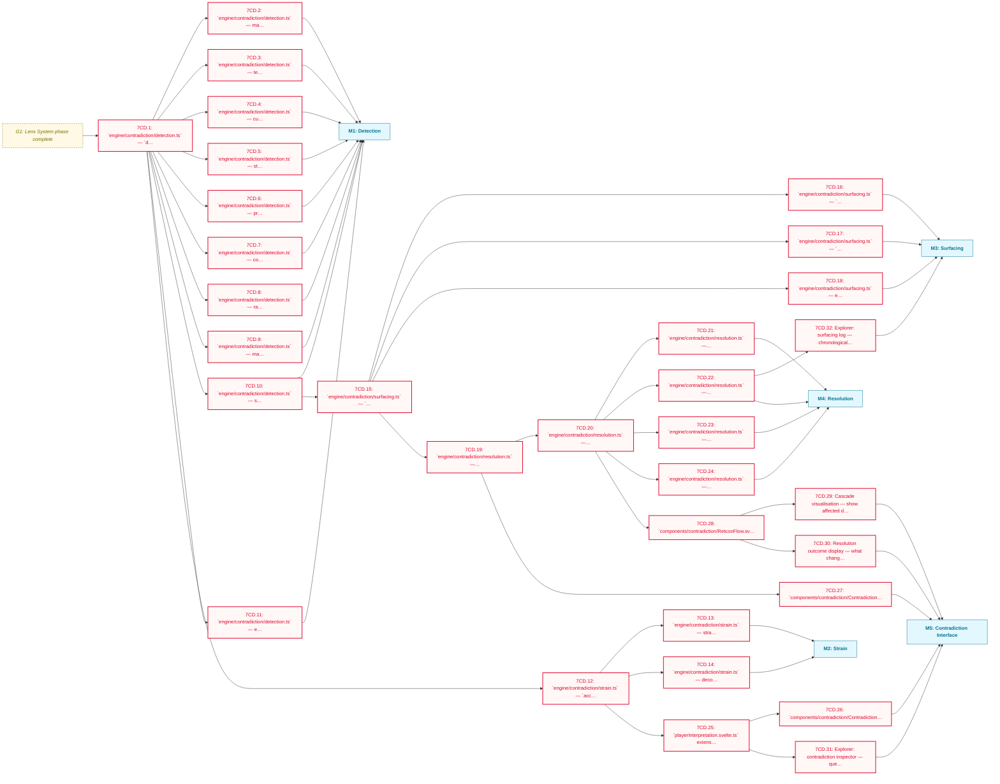

# Those Who Came Before: Contradictions

**State:** planned. Stored as `archived` until the roadmap plugin gains a planned phase state
(goblin-scout 3.x); promote it once the phase before it is done. Index: [roadmaps](README.md).

**Gate G1:** Lens System phase complete. Stands in for the cross-phase edge to Lens System. Lift it
when this phase is promoted to active: remove G1 from each blocked task's dependsOn and mark the
gate done.

---

## Milestone 1: Detection

**Goal:** Claims compared against occluded world state and the corpus, scored for severity

- [ ] **7CD.1** — `engine/contradiction/detection.ts` —
      `detectContradictions(artefact, model, worldState, corpus): Contradiction[]` — agent-generic
      detector _(blocked: depends on G1)_
- [ ] **7CD.2** — `engine/contradiction/detection.ts` — material contradiction rules (agent claims
      culture doesn't use material X, but artefact from that culture contains it) _(blocked —
      depends on 7CD.1)_
- [ ] **7CD.3** — `engine/contradiction/detection.ts` — temporal contradiction rules (chronology
      conflicts with stratigraphic evidence) _(blocked — depends on 7CD.1)_
- [ ] **7CD.4** — `engine/contradiction/detection.ts` — cultural contradiction rules (agent's
      `CulturalClaim`s about a culture contradicted by new artefact evidence; MVP substitutes
      `CulturalClaim` for the post-MVP cultural-profile document — see Beyond MVP) _(blocked —
      depends on 7CD.1)_
- [ ] **7CD.5** — `engine/contradiction/detection.ts` — structural contradiction rules (inference
      chain logical impossibility) _(blocked — depends on 7CD.1)_
- [ ] **7CD.6** — `engine/contradiction/detection.ts` — provenance contradiction rules (context
      attribution conflicts with origin) _(blocked — depends on 7CD.1)_
- [ ] **7CD.7** — `engine/contradiction/detection.ts` — corpus contradiction rules (agent claims vs
      professional consensus — NB: corpus may be wrong) _(blocked — depends on 7CD.1)_
- [ ] **7CD.8** — `engine/contradiction/detection.ts` — rarity contradiction rules (perceived rarity
      diverges from occluded distribution) _(blocked — depends on 7CD.1)_
- [ ] **7CD.9** — `engine/contradiction/detection.ts` — material provenance contradiction rules
      (wrong explanation for material presence despite correct identification) _(blocked — depends
      on 7CD.1)_
- [ ] **7CD.10** — `engine/contradiction/detection.ts` — severity scoring:
      `minor`/`moderate`/`major`/`critical` based on type, evidence weight, stakes _(blocked —
      depends on 7CD.1)_
- [ ] **7CD.11** — `engine/contradiction/detection.ts` — epistemic mode sensitivity:
      interpretive-mode observations more contradiction-prone than observational-mode _(blocked —
      depends on 7CD.1)_

---

## Milestone 2: Strain

**Goal:** Unresolved contradictions accumulate as strain on hypotheses

- [ ] **7CD.12** — `engine/contradiction/strain.ts` —
      `accumulateStrain(model, termIndex): Map<string, HypothesisStrain>` — per-hypothesis strain
      from reinterpretations, partial mismatches, missing evidence, peer doubt _(blocked — depends
      on 7CD.1)_
- [ ] **7CD.13** — `engine/contradiction/strain.ts` — strain threshold: exceeded → hypothesis
      "stressed", increases surfacing frequency and severity _(blocked — depends on 7CD.12)_
- [ ] **7CD.14** — `engine/contradiction/strain.ts` — decorative mismatch strain: motif outside
      expected cultural context adds small strain per occurrence _(blocked — depends on 7CD.12)_

---

## Milestone 3: Surfacing

**Goal:** Contradictions surface diegetically through channels that escalate

- [ ] **7CD.15** — `engine/contradiction/surfacing.ts` —
      `selectSurfacingChannel(contradiction, channels): DiegeticSurface` — choose channel by type
      _(blocked — depends on 7CD.10)_
- [ ] **7CD.16** — `engine/contradiction/surfacing.ts` — `impossible-artefact` channel: wrap a
      detected contradiction as a `DiegeticSurface` referencing the triggering artefact
      (`artefactId` + `anomaly` per doc 06 §4.5); no artefact generation here _(blocked — depends on
      7CD.15)_
- [ ] **7CD.17** — `engine/contradiction/surfacing.ts` — `field-report` channel: site finding that
      contradicts expectation _(blocked — depends on 7CD.15)_
- [ ] **7CD.18** — `engine/contradiction/surfacing.ts` — escalation: unresolved contradictions
      increase surfacing frequency per term _(blocked — depends on 7CD.15)_
- [ ] **7CD.32** — Explorer: surfacing log — chronological record of surfacing events, retcon
      history with cascade traces _(blocked — depends on 7CD.15, 7CD.22)_

---

## Milestone 4: Resolution

**Goal:** Tracing, resolving and cascading revisions, with their costs

- [ ] **7CD.19** — `engine/contradiction/resolution.ts` —
      `traceAffectedChain(contradiction, model): { proofId, brokenStep, affectedDocuments }` —
      identify challenged proof steps _(blocked — depends on 7CD.15)_
- [ ] **7CD.20** — `engine/contradiction/resolution.ts` —
      `resolve(contradiction, resolution, explanation): Resolution` — revise/reinterpret/reject
      _(blocked — depends on 7CD.19)_
- [ ] **7CD.21** — `engine/contradiction/resolution.ts` — revision cascades: revising hypothesis
      updates all dependent documents _(blocked — depends on 7CD.20)_
- [ ] **7CD.22** — `engine/contradiction/resolution.ts` — `RevisionRecord` creation on each
      resolution _(blocked — depends on 7CD.20)_
- [ ] **7CD.23** — `engine/contradiction/resolution.ts` — reinterpret strain: each reinterpretation
      of same hypothesis adds hidden strain _(blocked — depends on 7CD.20)_
- [ ] **7CD.24** — `engine/contradiction/resolution.ts` — reject credibility cost: rejecting
      evidence costs credibility, increases future contradiction pressure _(blocked — depends on
      7CD.20)_

---

## Milestone 5: Contradiction Interface

**Goal:** The queue, detail view and retcon flow the player works through

- [ ] **7CD.25** — `playerInterpretation.svelte.ts` extensions: `addContradiction()`,
      `updateStrain()`, contradiction queue reactive getters _(blocked — depends on 7CD.12)_
- [ ] **7CD.26** — `components/contradiction/ContradictionQueue.svelte` — list of queued
      contradictions with severity indicators _(blocked — depends on 7CD.25)_
- [ ] **7CD.27** — `components/contradiction/ContradictionDetail.svelte` — full view: evidence,
      trace to proof steps _(blocked — depends on 7CD.19)_
- [ ] **7CD.28** — `components/contradiction/RetconFlow.svelte` — step-by-step resolution:
      acknowledge → trace → decide → cascade → record _(blocked — depends on 7CD.20)_
- [ ] **7CD.29** — Cascade visualisation — show affected documents before confirming revision
      _(blocked — depends on 7CD.28)_
- [ ] **7CD.30** — Resolution outcome display — what changed and why _(blocked — depends on 7CD.28)_
- [ ] **7CD.31** — Explorer: contradiction inspector — queue with type, severity, strain levels,
      ground truth comparison _(blocked — depends on 7CD.25)_

---

## Dependency Diagram

