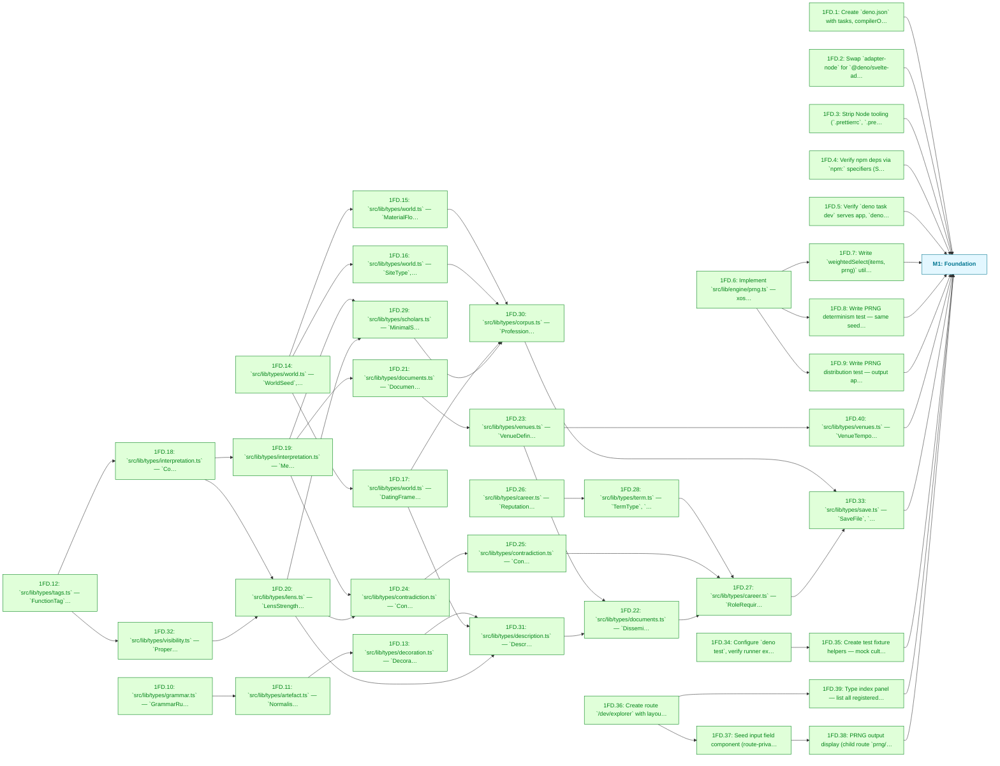

# Those Who Came Before: Foundation

**State:** complete. Index: [roadmaps](README.md).

---

## Milestone 1: Foundation

**Goal:** Deno runtime, type system, seeded PRNG, test infrastructure, Project Explorer shell

- [x] **1FD.21** — `src/lib/types/documents.ts` — `DocumentNode`, `DocumentLineage`,
      `DerivationType`, `DerivationEvent`, `DocumentScope`, `Audience`, `PublicationRegister`,
      `DocumentPerception` (simplified MVP shape per doc 10 §11: `audienceReach`,
      `takeawayDivergence`, `citationCount`; `DocumentNode` unavoidably references
      `DisseminationState`, so 1FD.22's full member list landed alongside it too)
- [x] **1FD.22** — `src/lib/types/documents.ts` — `DisseminationState`, `DisseminationEvent`,
      `DisseminationDetails`, `PeerReviewState`, `Retraction`, `TaintedLineage`
      (`DisseminationState` scoped to MVP's four states per doc 10 §11 — `presented`/`collected`
      deferred; completed alongside 1FD.21 since `DocumentNode` depends on it directly)
- [x] **1FD.23** — `src/lib/types/venues.ts` — `VenueDefinition`, `ContainerModel`, `TemporalMode`,
      `SubmissionWindow`, `EditorialProcess`, `AudienceEncounter`, `VenueScope`,
      `VenueClassification` (doc 07 §3.1 transcribed verbatim, term-denominated; doc 10 §6.4's
      week-denominated `VenueTemporalProfile` overlaps it — reconciliation owned by 1FD.40)
- [x] **1FD.24** — `src/lib/types/contradiction.ts` — `Contradiction` union,
      `MaterialContradiction`, `TemporalContradiction`, `CulturalContradiction`,
      `StructuralContradiction`, `ProvenanceContradiction`, `CorpusContradiction`,
      `RarityContradiction`, `MaterialProvenanceContradiction` (all eight members per doc 06 §4.2;
      `CulturalContradiction.agentClaim` references a claimId at MVP — doc 06's profileId applies
      once cultural-profile documents land post-MVP; `ContradictionSeverity` landed here from
      1FD.25's bullet since all eight members reference it directly, per the 1FD.21/22 precedent)
- [x] **1FD.25** — `src/lib/types/contradiction.ts` — `ContradictionQueue`, `QueuedContradiction`,
      `DiegeticSurface`, `Resolution`, `HypothesisStrain` (doc 06 §4.4–§4.6, §5 verbatim;
      `HypothesisStrain` is the canonical strain type per doc 12 §2.15; all six `DiegeticSurface`
      channels typed though MVP drives only `impossible-artefact`/`field-report` — doc 07 §5.2's NPC
      generators already return the other shapes; `ContradictionQueue` shaped per doc 06, with doc
      08 §3.4's bare-`Contradiction`-push store sketch JSDoc-flagged as illustrative pseudo-code to
      reconcile at the store task; `Resolution.contradictionId` flagged as a doc 06 forward
      reference — `Contradiction` members carry no `id` at MVP, the identity scheme belongs to the
      detection engine (7CD.x); resolves the two cross-file `TODO(1FD.25)` stand-ins in
      `interpretation.ts`; `ContradictionSeverity` already landed with 1FD.24)
- [x] **1FD.27** — `src/lib/types/career.ts` — `RoleRequirement`, `DisseminationCareerEffect`,
      `PeerReviewCareerEvent`, `ReviewerFeedback` (doc 07 §3.2–§3.3, §4.2 verbatim;
      `DisseminationTransition` hoisted from §3.2 per the `ContradictionSeverity` precedent and
      scoped to MVP's three live transitions — `published-to-collected` dropped per the 1FD.22
      `DisseminationState` precedent; authored `ReputationEffect` hoist for the
      `{dimension, delta, basis}` shape doc 07 inlines identically on both career-event types; doc
      08 §5's singular `reputationEffect` read in the `resolvePeerReview` sketch JSDoc-flagged — doc
      07's plural array governs; `ActivityOutcome`'s provisional note updated now this task has
      landed, it stays provisional until activity execution gets an owning task per doc 13 §5; file
      remains import-free, cross-domain references by plain `string` id)
- [x] **1FD.29** — `src/lib/types/scholars.ts` — `MinimalScholar`, `NPCScholarSeed`,
      `SimulatedExcavation` (doc 07 §5.1 + doc 05 §4.1;
      `MinimalScholar.specialism.methodologicalBias` narrowed from the doc's `string` to
      interpretation.ts's `MethodologicalBias` union per the 1FD.31 register-narrowing precedent)
- [x] **1FD.30** — `src/lib/types/corpus.ts` — `ProfessionalCorpus`, `FrequencyRecord`,
      `ContextFrequency`, `ConsensusStatement`, `Debate`, `DebatePosition`, `CoverageBudget` (doc 05
      §4.2–§4.3 verbatim; `ContextFrequency` is named by `ProfessionalCorpus.contextAssociations`
      but shaped nowhere — authored provisional per the
      `MotifSet`/`ActivityOutcome`/`ProvenancePresentation` precedent, as the reverse index of
      `FrequencyRecord.byContext` —
      `{totalObserved, byCulture, associatedMaterials, associatedForms, lastUpdated}` — to firm up
      at 2GN.53, the first real producer; `SiteType` imported from world.ts per the scholars.ts
      precedent; cross-domain references — NPC ids, document node ids, culture ids, period ids —
      stay plain `string` per the career.ts convention)
- [x] **1FD.33** — `src/lib/types/save.ts` — `SaveFile`, `SerialisedWorldState`,
      `SerialisedInterpretiveModel`, `SerialisedTermState`, `CURRENT_SAVE_VERSION` (doc 08 §4.1
      transcribed verbatim for `SaveFile`/`CURRENT_SAVE_VERSION`; persistence scope per doc 12 §2.14
      — lensState recomputed on load, contradiction queue nested inside `playerInterpretation`; the
      three `Serialised*` shapes are doc-named but shaped nowhere — authored via an exported
      recursive `Serialised<T>` utility, the single type-level encoding of doc 08 §4.2's
      Map→`[K,V][]` rule (functions map to `never` so non-serialisable state like `WorldSeed.prng`
      is a loud compile error at 8PS.2, not a silent `{}`; homomorphic branches preserve tuple
      arity, optionality and readonly), making `SerialisedInterpretiveModel`/`SerialisedTermState`
      derived aliases with zero drift by construction — a flagged deviation from the
      interfaces-first convention; `SerialisedWorldState` is an explicit PROVISIONAL interface
      authored against doc 08 §3.3's field tree since no runtime `WorldState` aggregate exists until
      3WS.9/3WS.10 — `sites` landed as `datingFrameworks` (no standalone Site entity, site data
      lives inline on `Provenance.site`), `lineageGraph` as `lineageEvents` (graph edges are
      recoverable from `DocumentNode.lineage`; `DerivationEvent` records the modified/dropped
      commitments that aren't), plus three authored additions the tree omits but the world
      demonstrably needs saved — `cultures` (the tree's chronology line says "Periods, cultures" but
      `WorldChronology` holds only timelines, the Map-bearing `Culture` profiles live nowhere else),
      `geology` and `corpus` (the contradiction detector's two comparison sources, doc 06
      §4.2–§4.3); player `CareerState`/`Reputation` placement, PRNG draw position and
      `SimulatedExcavation` persistence recorded as known omissions for 3WS.10/8PS.2 to resolve;
      world.ts's stale `persistence/save.ts` pointer corrected to this file; verified by throwaway
      compile-time assertions — value-level round-trip tests land with 8PS.1)
- [x] **1FD.40** — `src/lib/types/venues.ts` — `VenueTemporalProfile` (doc 10 §6.4,
      week-denominated: `submissionMode`, `openWeeks`, `cycleLengthWeeks`, `reviewLeadTimeWeeks`,
      `publicationLeadTimeWeeks`); reconcile with doc 07 §3.1's term-denominated
      `TemporalMode`/`SubmissionWindow` (supersede or coexist — doc 12's week-conversion sweep
      suggests weeks are canonical, cf. §2.9 precedent) and record the resolution in doc 12;
      consumed downstream by 9CR.5 (venue generation sets temporal properties) and 9CR.22 (venue
      cycles at term boundaries) (resolved as **supersede**, recorded as doc 12 §2.17: the §2.9 week
      sweep updated doc 10's profile but never doc 07, and `PeerReviewState` (1FD.22) already works
      in absolute weeks — so `TemporalMode`/`SubmissionWindow` removed,
      `VenueDefinition.temporalMode` → `temporalProfile: VenueTemporalProfile`, transcribed verbatim
      with `venueId` kept as self-referential when embedded; `TemporalMode.visibilityWindow` had no
      week equivalent and no consumer anywhere — dropped for MVP per the `presented`/`collected`
      `DisseminationState` precedent rather than converted; doc 07 §3.1 gained a supersession note)
- [x] **1FD.39** — Type index panel — list all registered interfaces with field summaries (child
      route `types/+page.svelte` per the 1FD.36 sub-route model, `panels.ts` entry flipped to
      `available`; the index is parsed live from the type modules' raw sources — an
      `import.meta.glob` `?raw` sweep of `src/lib/types/*.ts` (test files excluded, `term.test.ts`
      lives there) feeds the route-private `typeIndex.ts` parser, built on the TypeScript compiler
      API (`ts.createSourceFile`, parse-only, no `Program`) since regex parsing can't survive
      `save.ts`'s recursive conditional `Serialised<T>` or fields wrapped across lines by deno fmt;
      parsing runs in a `+page.server.ts` load so the multi-megabyte `typescript` module (already a
      dependency via svelte-check) never reaches the client bundle, and the glob keeps the panel
      zero-maintenance — new type modules appear automatically, the index cannot drift from the
      code; interfaces render their extends clause and a field table (name, `?`, `readonly`, type
      text, first-sentence field JSDoc), string-literal-union aliases render member badges, other
      aliases raw type text, exported consts/functions land in a per-module "also exports" footnote;
      client-side filter matches type, field and union-member names and auto-expands matching
      modules; `deno task test` gained `--allow-env` because typescript reads `process.env` at
      module init; parser covered by 8 Deno tests, panel verified in-browser — 17 modules, 106
      interfaces + 41 aliases, matching the source count exactly; extended post-completion with
      reference visualisations, since the reference graph — not inheritance, of which exactly one
      `extends` exists — is where the density lives: a mermaid module dependency graph (17 nodes),
      per-type reference-neighbourhood diagrams via a graph toggle on each card (the full ~150-node
      type graph is deliberately not drawn — unreadable hairball) and clickable cross-reference
      jumps on type names; mermaid renders client-side in its own lazy chunk, the parser
      additionally extracts raw type references and sibling-module imports, filtered against the
      name registry server-side)
- [x] **1FD.1** — Create `deno.json` with tasks, compilerOptions, fmt/lint config
- [x] **1FD.2** — Swap `adapter-node` for `@deno/svelte-adapter` in `svelte.config.js`
- [x] **1FD.3** — Strip Node tooling (`.prettierrc`, `.prettierignore`, `.npmrc`)
- [x] **1FD.4** — Verify npm deps via `npm:` specifiers (Svelte 5, SvelteKit 2, Vite 7, Tailwind 4,
      DaisyUI 5)
- [x] **1FD.5** — Verify `deno task dev` serves app, `deno task check` passes
- [x] **1FD.6** — Implement `src/lib/engine/prng.ts` — xoshiro128** algorithm,
      `createPrng(seed: string): () => number`
- [x] **1FD.7** — Write `weightedSelect(items, prng)` utility (reused across pipeline)
- [x] **1FD.8** — Write PRNG determinism test — same seed → identical sequence
- [x] **1FD.9** — Write PRNG distribution test — output approximately uniform over large sample
- [x] **1FD.12** — `src/lib/types/tags.ts` — `FunctionTag`, `ContextTag`, `MaterialTag`,
      `ClassificationRule`, `ClaimMagnitude` (built ahead of 1FD.10 so `grammar.ts` could import the
      real `MaterialTag` rather than a placeholder; `ClassificationRule.condition` typed against a
      local `ExtractedFeatures` stand-in until 1FD.11 landed, now imports the real type from
      `artefact.ts`)
- [x] **1FD.10** — `src/lib/types/grammar.ts` — `GrammarRule`, `GrammarOption`,
      `ArrangementPattern`, `AccumulationConstraints`, `AttachmentType` (imports `MaterialTag` from
      1FD.12; `GrammarOption.expandsTo` and `.phaseModifiers` are provisional shapes, JSDoc-marked,
      pending 2GN.3/2GN.5)
- [x] **1FD.11** — `src/lib/types/artefact.ts` — `NormalisedArtefact`, `NormalisedComponent`,
      `Attachment`, `ObjectDimensions`, `Portability`, `InspectionDepth`, `ClassifiedArtefact`,
      `ExtractedFeatures`, `MaterialAssignment`, `MaterialDefinition`, `MaterialProvenance` (doc 05
      §5.2, §6.1, §7, §9; `MaterialDefinition` has no doc 05 field shape, adopted the
      `{id, displayName, tags}` shape from `docs/dev/implementation/m1-artefact-generation.md` — doc
      05 §15's richer geological/cultural fields deferred until
      `GeologicalContext`/`CulturalProfile` exist;
      `ClassifiedArtefact.decorativeLayers`/`.provenance` now import the real
      `DecorativeLayer`/`Provenance` from `decoration.ts`/`world.ts`, both landed with
      1FD.13/1FD.16)
- [x] **1FD.13** — `src/lib/types/decoration.ts` — `DecorativeTechnique`, `DecorativeLayer` (doc 05
      §8.2–§8.3; `DecorativeTechnique` is a flat 16-member union, not a discriminated union with
      per-technique params, since `DecorativeLayer` only carries generic `motifRef?`/`material?`
      slots; material-prerequisite rules are engine/data-layer concerns, not typed here — see
      roadmap 2GN.28/2GN.30; resolves the `TODO(1FD.13)` stand-in in `artefact.ts`)
- [x] **1FD.14** — `src/lib/types/world.ts` — `WorldSeed`, `PhaseCharacteristics`, `CulturePhase`,
      `CultureTimeline`, `CulturalProfile`, `Culture`, `CraftInvestmentProfile`, `MotifSet`,
      `MotifDefinition`, `WorldChronology` (doc 05 §2, §3.1–§3.3; `MotifSet`/`MotifDefinition` are
      invented, provisional, not doc-specified — minimal shape so `DecorativeLayer.motifRef` can
      reference one by id; `CulturalProfile`'s JSDoc flags the unrelated same-named type in doc 06
      §3.3; built together with 1FD.15/1FD.16 in the same file since `CraftInvestmentProfile` and
      `WorldChronology` reference their types directly)
- [x] **1FD.15** — `src/lib/types/world.ts` — `MaterialFlow`, `RelationshipDynamics`,
      `RelationshipPhase`, `CultureRelationship` (doc 05 §3.4, fully specified verbatim; built
      alongside 1FD.14/1FD.16)
- [x] **1FD.16** — `src/lib/types/world.ts` — `SiteType`, `PreservationState`, `DepositionType`,
      `Provenance`, `AvailabilityLevel`, `RegionalAvailability`, `GeologicalContext` (doc 05
      §3.5–§3.6, fully specified verbatim; `Provenance`'s JSDoc distinguishes it from
      `MaterialProvenance` in `artefact.ts`; resolves the `TODO(1FD.16)` stand-in in `artefact.ts`;
      built alongside 1FD.14/1FD.15)
- [x] **1FD.18** — `src/lib/types/interpretation.ts` — `Confidence`, `Observation`, `EvidenceLink`,
      `InferenceScope`, `Inference`, `Hypothesis`, `InterpretiveModel` (doc 06 §2.1–§2.3, doc 08
      §3.2; `InterpretiveModel` uses the doc 08 §3.2 "claims" shape rather than doc 06 §6's
      "knowledge layers" shape — the two docs conflict, and doc 08's version matches this roadmap's
      own field ownership (1FD.19, 1FD.25) and the concrete store-construction code in doc 08 §3.4;
      `Observation.observationRegister` is typed as the inline MVP three-value union pending
      `DescriptionRegister` from 1FD.20/1FD.31; `InterpretiveModel`'s five 1FD.19-owned fields were
      private `unknown` placeholders until 1FD.19 landed, its two 1FD.25-owned fields still are)
- [x] **1FD.19** — `src/lib/types/interpretation.ts` — `MethodologicalBias`, `CulturalClaim`,
      `ArtefactClaim`, `ChronoClaim`, `AgentAssessment`, `MethodologicalProfile` (doc 08 §3.2 names
      all five as `InterpretiveModel` members but gives no field shapes; authored against downstream
      consumers instead — the contradiction detector's `agentClaim: { claimId, claim }` contract
      (doc 06 §4.2, 1FD.24) requires `id` + `claim: string` on the three claim types, and the player
      store's `Map` usage (doc 08 §3.4) requires `id`-keying and a `status` union including
      `'active'`, reusing the `'active' | 'challenged' | 'retracted'` union already on
      `Inference`/`Hypothesis`; `MethodologicalBias` is an authored union —
      `'materialist' | 'structuralist' | 'culturalist'` from doc 07 §5.1 plus an authored
      `'generalist'` neutral member so the union stays total (no optional `bias` field) and
      `MethodologicalProfile` has a sensible non-empty default (`bias: 'generalist'`, all `weights`
      at `1.0`) for the `defaultMethodology()` factory, 3WS.11; strain lives in `HypothesisStrain`,
      1FD.25 — the name `StrainScore` is retired; resolves the five same-file `TODO(1FD.19)`
      stand-ins in `interpretation.ts`)
- [x] **1FD.26** — `src/lib/types/career.ts` — `Reputation`, `ReputationModifier`, `ReputationGate`,
      `CareerState`, `AcademicRole`, `CareerActivity`, `ActivityType` (doc 07 §2, §2.2, §4.0–§4.1,
      fully specified verbatim and self-contained; `CareerActivity.outcomes: ActivityOutcome[]`
      needed an invented, provisional `ActivityOutcome` shape — doc 07 names it only as a comment,
      "Possible results", with no roadmap task owning it)
- [x] **1FD.32** — `src/lib/types/visibility.ts` — `PropertyVisibility` (string-literal union, not a
      TS `enum`, per the convention already committed in `artefact.ts`'s module JSDoc),
      `PROPERTY_VISIBILITY_VALUES`, `isPropertyVisibility` (doc 11 §2.7 authoritative; helpers kept
      minimal since there's no consumer yet — `lens.ts`, 1FD.20, is the first)
- [x] **1FD.17** — `src/lib/types/world.ts` — `DatingFramework`, `LayerDating`, `DatingMethod` (doc
      05 §4.7, fully specified verbatim; `DatingConfidence` hoisted from the doc's inline union on
      `DatingFramework.confidence` per the `ClaimStatus` precedent in interpretation.ts —
      `ProvenancePresentation.dating`, 1FD.31, is the second consumer)
- [x] **1FD.28** — `src/lib/types/term.ts` — `TermType`, `AcademicYear`, `TermState`,
      `BackgroundDrain`, `CompletedAction` (doc 08 §3.6 verbatim, which supersedes doc 07's older
      sketches per doc 12 §2.9), constants (`WEEKS_PER_TERM`, `TERMS_PER_YEAR`, plus
      `WEEKS_PER_YEAR` from the same doc block), helpers (`termStartWeek`, `weekInTerm`,
      `termIndexFromWeek`, `yearFromTerm`; all 0-based per doc 11 §2.8, covered by `term.test.ts`;
      `getTermType(termIndex)` deliberately excluded — it belongs to 9CR.20,
      `engine/career/progression.ts`)
- [x] **1FD.20** — `src/lib/types/lens.ts` — `LensStrength`, `ObservationSalience`,
      `ClassificationSuggestion`, `CrossReference`, `DescriptionFrame`, `OmissionCheck`, `LensState`
      (doc 04 §3.1–§3.5, §4, incl. the graduated dissemination factor with 0.15 presented per doc 12
      §2.16; `LensState` is named by doc 06 §6 and 6LS.2/6LS.4 but shaped nowhere — landed as a
      flagged provisional design, per-hypothesis `strengths` Map + aggregated `tagWeights` +
      `computedAtTerm`, to firm up at 6LS.2/6LS.3; also owns `DescriptionRegister` (doc 04 §3.4),
      moved here from the 1FD.31 bullet because `DescriptionFrame` keys a `Record` on it and
      description.ts already imports lens.ts, keeping imports one-directional; resolves the
      `observationRegister` inline-union TODO in interpretation.ts from 1FD.18)
- [x] **1FD.31** — `src/lib/types/description.ts` — `DescriptionTemplate`, `DescriptionVariant`,
      `ArtefactPresentation`, `PresentedObservation`, `TagSuggestion`, `ProvenancePresentation` (doc
      05 §13.1–§13.2; both `register` fields narrowed from the doc's five-value
      `ObservationRegister` to the three-value `DescriptionRegister` per doc 12 §2.10 — the
      five-register model + `RegisterAccess` is post-MVP, doc 13 §4; `DescriptionRegister` itself
      lives in lens.ts under 1FD.20, imported here; `ProvenancePresentation` is named by
      `ArtefactPresentation.provenance` but shaped nowhere — landed as a flagged provisional
      player-visible projection of world.ts `Provenance`, `cultureId`/`phaseId`/`year` deliberately
      absent with an optional corpus-derived `dating` block per doc 05 §4.7, to firm up at 2GN.38)
- [x] **1FD.34** — Configure `deno test`, verify runner executes against engine skeleton
      (`deno task test` wired in `deno.json`; `@std/assert@^1.0.19` added; `tsconfig.json` excludes
      `*.test.ts` from `svelte-check` since Deno test files use `Deno.ns`/`jsr:` specifiers
      svelte-check can't resolve)
- [x] **1FD.35** — Create test fixture helpers — mock culture, mock world seed, mock artefact
      factories (split per-domain, mirroring `src/lib/types/`: `tests/fixtures/world.ts` keeps
      `mockWorldSeed`, now returning the real `WorldSeed` instead of a local stand-in;
      `tests/fixtures/culture.ts` adds `mockCulture`; `tests/fixtures/artefact.ts` adds
      `mockNormalisedArtefact` and `mockArtefact`; each takes a shallow-merge `overrides` param that
      replaces whole top-level branches rather than deep-merging, since several fields are `Map`s or
      multi-level nested objects; `tsconfig.json`'s `exclude` extended to `tests/**/*.test.ts`
      alongside the existing `src/**/*.test.ts` for the same Deno-only reason)
- [x] **1FD.36** — Create route `/dev/explorer` with layout and nav (sub-route model: each future
      panel is a child route under `src/routes/dev/explorer/` plus one entry in the route-private
      `panels.ts` registry — `{id, label, path, milestone, status}` — which drives both the sidebar
      `menu` nav and the overview landing table; planned M1 panels render as `menu-disabled`
      placeholders until 1FD.38/39 flip their status; seed input, 1FD.37, is a shell control not a
      panel — the layout's header bar reserves its right-hand mount point;
      `src/routes/dev/+layout.ts` guards the whole `/dev` subtree with a 404 outside `dev` builds;
      also created the root `src/routes/+layout.svelte` as a prerequisite fix — nothing imported
      `app.css`, so Tailwind/DaisyUI styles never loaded anywhere)
- [x] **1FD.37** — Seed input field component (route-private `SeedInput.svelte` mounted in the
      layout header's reserved slot; the seed lives in the `?seed=` URL query param so it survives
      reload and repro cases are shareable via link — `seed.ts` owns `DEFAULT_SEED` and
      `getSeed(url)`, with absent/empty falling back to the default and committing the default or an
      empty value removing the param; the layout nav and overview table links now carry
      `page.url.search` so the seed survives panel switches)
- [x] **1FD.38** — PRNG output display (child route `prng/+page.svelte` per the 1FD.36 sub-route
      model, `panels.ts` entry flipped to `available`; draws N values — default 20, clamped 1–1000 —
      from two _independent_ `createPrng(seed)` instances and compares index-by-index with exact
      float equality; the visual determinism check is a badge verdict plus per-row ✓/✗ over
      full-precision values; everything is `$derived` from the URL seed and N, so changing the
      header seed regenerates the panel live with no generate button)

---

## Dependency Diagram

