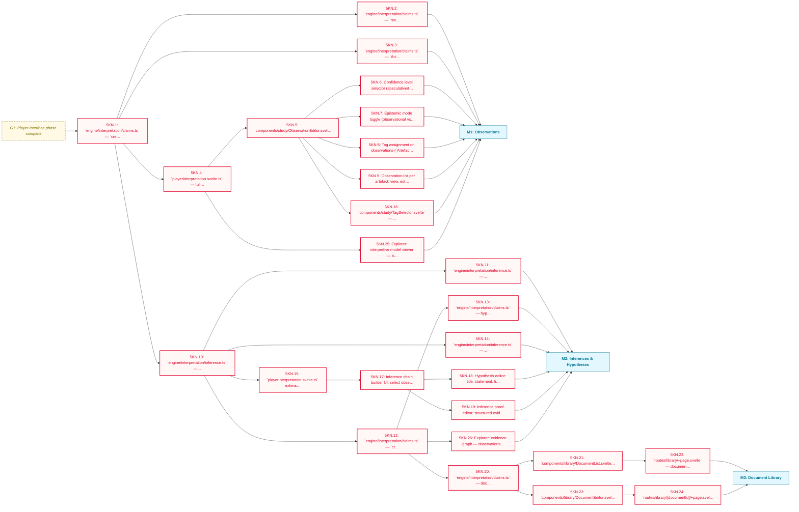

# Those Who Came Before: Knowledge Model

**State:** planned. Stored as `archived` until the roadmap plugin gains a planned phase state
(goblin-scout 3.x); promote it once the phase before it is done. Index: [roadmaps](README.md).

**Gate G1:** Player Interface phase complete. Stands in for the cross-phase edge to Player
Interface. Lift it when this phase is promoted to active: remove G1 from each blocked task's
dependsOn and mark the gate done.

---

## Milestone 1: Observations

**Goal:** The player records, revises and tags observations against artefacts, components and
decoration

- [ ] **5KN.1** — `engine/interpretation/claims.ts` —
      `createObservation(artefactId, componentRef?, decorativeRef?, content, tags, confidence, epistemicMode, register): Observation`
      — full `Observation` shape per doc 06 §2.1 _(blocked: depends on G1)_
- [ ] **5KN.2** — `engine/interpretation/claims.ts` —
      `reviseObservation(id, newContent, newConfidence)` with superseded-by chain _(blocked —
      depends on 5KN.1)_
- [ ] **5KN.3** — `engine/interpretation/claims.ts` — `ArtefactStudy` creation: collection of
      observations for a single artefact _(blocked — depends on 5KN.1)_
- [ ] **5KN.4** — `playerInterpretation.svelte.ts` — full implementation: `addObservation()`,
      `updateObservation()`, `deleteObservation()`, `addArtefactStudy()`, reactive getters by
      artefact _(blocked — depends on 5KN.1)_
- [ ] **5KN.5** — `components/study/ObservationEditor.svelte` — text editor for observation notes,
      attached to component/group/decorative element _(blocked — depends on 5KN.4)_
- [ ] **5KN.6** — Confidence level selector (speculative/tentative/confident/certain) _(blocked —
      depends on 5KN.5)_
- [ ] **5KN.7** — Epistemic mode toggle (observational vs interpretive) _(blocked — depends on
      5KN.5)_
- [ ] **5KN.8** — Tag assignment on observations (`ArtefactTag` multi-select) _(blocked — depends on
      5KN.5)_
- [ ] **5KN.9** — Observation list per artefact: view, edit, delete _(blocked — depends on 5KN.5)_
- [ ] **5KN.16** — `components/study/TagSelector.svelte` — tag selection UI for observations,
      inferences, hypotheses _(blocked — depends on 5KN.5)_
- [ ] **5KN.25** — Explorer: interpretive model viewer — browse observations,
      observation-to-artefact linkages, confidence levels _(blocked — depends on 5KN.4)_

---

## Milestone 2: Inferences & Hypotheses

**Goal:** Observations chain into inferences, proofs and hypotheses with explicit evidence

- [ ] **5KN.10** — `engine/interpretation/inference.ts` —
      `createInference(conclusion, evidenceChain, tags, scope, confidence): Inference` — link
      observations across artefacts _(blocked — depends on 5KN.1)_
- [ ] **5KN.11** — `engine/interpretation/inference.ts` — evidence chain validation: ensure all
      source IDs exist, roles valid _(blocked — depends on 5KN.10)_
- [ ] **5KN.12** — `engine/interpretation/claims.ts` —
      `createHypothesis(title, statement, supportingInferences, tags, scope, confidence): Hypothesis`
      _(blocked — depends on 5KN.10)_
- [ ] **5KN.13** — `engine/interpretation/claims.ts` — hypothesis status management: `active` →
      `challenged` → `retracted` transitions _(blocked — depends on 5KN.12)_
- [ ] **5KN.14** — `engine/interpretation/inference.ts` —
      `createInferenceProof(title, conclusion, chain)`: structured evidence chain with explicit
      assumption steps _(blocked — depends on 5KN.10)_
- [ ] **5KN.15** — `playerInterpretation.svelte.ts` extensions: `addInference()`, `addHypothesis()`,
      `addInferenceProof()`, `addMaterialGeneralisation()` _(blocked — depends on 5KN.10)_
- [ ] **5KN.17** — Inference chain builder UI: select observations across artefacts, link into
      evidence chain, specify roles _(blocked — depends on 5KN.15)_
- [ ] **5KN.18** — Hypothesis editor: title, statement, link supporting inferences, set confidence
      _(blocked — depends on 5KN.17)_
- [ ] **5KN.19** — Inference proof editor: structured evidence chain with explicit assumption steps
      per step _(blocked — depends on 5KN.17)_
- [ ] **5KN.26** — Explorer: evidence graph — observations → inferences → hypotheses with dependency
      edges, orphaned node highlighting _(blocked — depends on 5KN.12)_

---

## Milestone 3: Document Library

**Goal:** Working documents drafted, listed and edited in a library

- [ ] **5KN.20** — `engine/interpretation/claims.ts` — document type definitions (artefact studies,
      material generalisations, inference proofs) _(blocked — depends on 5KN.12)_
- [ ] **5KN.21** — `components/library/DocumentList.svelte` — document library listing all player
      documents _(blocked — depends on 5KN.20)_
- [ ] **5KN.22** — `components/library/DocumentEditor.svelte` — draft creation, commitment editing
      for working documents _(blocked — depends on 5KN.20)_
- [ ] **5KN.23** — `routes/library/+page.svelte` — document library route _(blocked — depends on
      5KN.21)_
- [ ] **5KN.24** — `routes/library/[documentId]/+page.svelte` — individual document view/edit
      _(blocked — depends on 5KN.22)_

---

## Dependency Diagram

