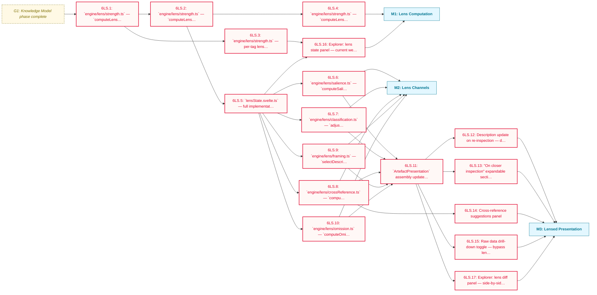

# Those Who Came Before: Lens System

**State:** planned. Stored as `archived` until the roadmap plugin gains a planned phase state
(goblin-scout 3.x); promote it once the phase before it is done. Index: [roadmaps](README.md).

**Gate G1:** Knowledge Model phase complete. Stands in for the cross-phase edge to Knowledge Model.
Lift it when this phase is promoted to active: remove G1 from each blocked task's dependsOn, empty
the gate's blocks, mark the gate done, then run roadmap.py recompute and validate.

---

## Milestone 1: Lens Computation

**Goal:** Lens strength and per-tag weights computed from the interpretive model, with decay

- [ ] **6LS.1** — `engine/lens/strength.ts` —
      `computeLensStrength(hypothesis, model, documents, venues): LensStrength` — dissemination
      (private 0, circulated 0.1, presented 0.15, submitted 0.2, published 0.3, collected 0.35),
      venuePrestige (0-1 multiplier), confidence (0-1), evidenceCount (log2×0.1, cap 0.3), taught
      (+0.2), cited (0.05/citation, cap 0.2), contradictions (-0.1 each), sabbatical (-0.15)
      _(blocked: depends on G1)_
- [ ] **6LS.2** — `engine/lens/strength.ts` — `computeLens(model, documents, venues): LensState` —
      full lens state from all hypotheses _(blocked — depends on 6LS.1)_
- [ ] **6LS.3** — `engine/lens/strength.ts` — per-tag lens weights: each hypothesis contributes
      specific tag boosts/suppressions based on tags + strength _(blocked — depends on 6LS.1)_
- [ ] **6LS.4** — `engine/lens/strength.ts` —
      `computeLensWithDecay(model, documents, venues, termIndex): LensState` — natural decay
      (-0.02/term unpublished, -0.01/term published), contradiction pressure (-0.05/term
      cumulative), sabbatical flat reduction _(blocked — depends on 6LS.2)_
- [ ] **6LS.5** — `lensState.svelte.ts` — full implementation: reactive lens state,
      `update(newLens)`, derived per-tag weight getters _(blocked — depends on 6LS.2)_
- [ ] **6LS.16** — Explorer: lens state panel — current weights per tag, contributing hypotheses,
      strength formula breakdown _(blocked — depends on 6LS.5, 6LS.3)_

---

## Milestone 2: Lens Channels

**Goal:** Salience, classification, cross-reference, framing and omission channels

- [ ] **6LS.6** — `engine/lens/salience.ts` —
      `computeSalience(artefact, lensState): ObservationSalience[]` — reorder properties by
      hypothesis alignment, finalWeight clamped [0.1, 3.0], below-threshold → "on closer inspection"
      _(blocked — depends on 6LS.5)_
- [ ] **6LS.7** — `engine/lens/classification.ts` —
      `adjustClassificationSuggestions(baseTags, lensState): ClassificationSuggestion[]` —
      boost/suppress tag scores by lens alignment _(blocked — depends on 6LS.5)_
- [ ] **6LS.8** — `engine/lens/crossReference.ts` —
      `computeCrossReferences(artefact, model, lensState): CrossReference[]` — related artefacts
      with hypothesis-biased matching, `potentiallyMisleading` flag _(blocked — depends on 6LS.5)_
- [ ] **6LS.9** — `engine/lens/framing.ts` —
      `selectDescriptionFrame(property, lensState, registers): DescriptionFrame` — lens selects
      register + within-register variant _(blocked — depends on 6LS.5)_
- [ ] **6LS.10** — `engine/lens/omission.ts` —
      `computeOmissions(artefact, lensState): OmissionCheck[]` — de-emphasise contradicting
      properties, suppression capped _(blocked — depends on 6LS.5)_

---

## Milestone 3: Lensed Presentation

**Goal:** The artefact presentation filtered through the lens, with drill-down past it

- [ ] **6LS.11** — `ArtefactPresentation` assembly update — use lens for `primaryObservations`
      sorting, `suggestedTags` boosting, `crossReferences` priming, description framing _(blocked —
      depends on 6LS.6, 6LS.7, 6LS.8, 6LS.9, 6LS.10)_
- [ ] **6LS.12** — Description update on re-inspection — descriptions change when player revisits
      artefacts after forming hypotheses _(blocked — depends on 6LS.11)_
- [ ] **6LS.13** — "On closer inspection" expandable section for low-salience properties _(blocked —
      depends on 6LS.11)_
- [ ] **6LS.14** — Cross-reference suggestions panel _(blocked — depends on 6LS.8)_
- [ ] **6LS.15** — Raw data drill-down toggle — bypass lens to see unfiltered properties _(blocked —
      depends on 6LS.11)_
- [ ] **6LS.17** — Explorer: lens diff panel — side-by-side lens-on vs lens-off, salience changes,
      tag adjustments, suppressed properties _(blocked — depends on 6LS.11)_

---

## Dependency Diagram

