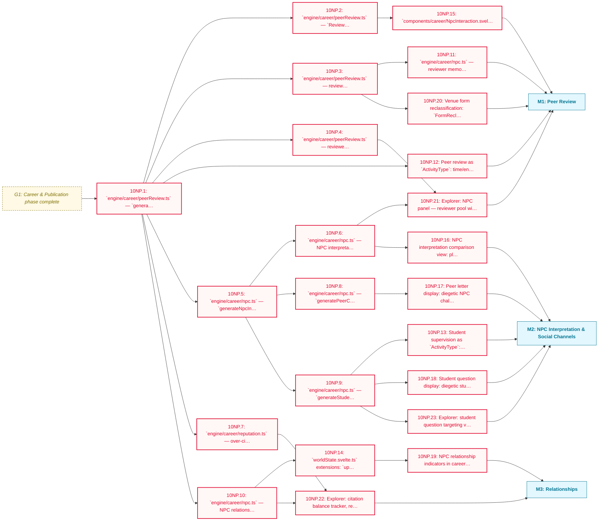

# Those Who Came Before: NPC Systems

**State:** planned. Stored as `archived` until the roadmap plugin gains a planned phase state
(goblin-scout 3.x); promote it once the phase before it is done. Index: [roadmaps](README.md).

**Gate G1:** Career & Publication phase complete. Stands in for the cross-phase edge to Career &
Publication. Lift it when this phase is promoted to active: remove G1 from each blocked task's
dependsOn, empty the gate's blocks, mark the gate done, then run roadmap.py recompute and validate.

---

## Milestone 1: Peer Review

**Goal:** Named NPC reviewers judge submissions and remember them

- [ ] **10NP.1** — `engine/career/peerReview.ts` —
      `generatePeerReview(document, reviewer, worldState, noise): PeerReviewCareerEvent` — compare
      commitments against world state (with noise), reviewer's model, reviewer's bias _(blocked:
      depends on G1)_
- [ ] **10NP.2** — `engine/career/peerReview.ts` — `ReviewerFeedback` generation: diegetic
      assessment text, methodological concerns, commitments disputed/endorsed _(blocked — depends on
      10NP.1)_
- [ ] **10NP.3** — `engine/career/peerReview.ts` — review outcome determination: accepted /
      revisions-requested / rejected based on commitment match, evidence quality, venue fit
      _(blocked — depends on 10NP.1)_
- [ ] **10NP.4** — `engine/career/peerReview.ts` — reviewer selection: choose from NPC pool based on
      specialism alignment with document scope _(blocked — depends on 10NP.1)_
- [ ] **10NP.11** — `engine/career/npc.ts` — reviewer memory: reviewer who previously rejected
      brings context to new submissions _(blocked — depends on 10NP.3)_
- [ ] **10NP.12** — Peer review as `ActivityType`: time/energy cost (2-3 weeks, 8 + 2/week), exposes
      alternative interpretations _(blocked — depends on 10NP.1)_
- [ ] **10NP.15** — `components/career/NpcInteraction.svelte` — peer review display: reviewer
      feedback, disputed/endorsed commitments _(blocked — depends on 10NP.2)_
- [ ] **10NP.20** — Venue form reclassification: `FormReclassificationEvent` with direction
      (downward/upward/lateral), editor correspondence _(blocked — depends on 10NP.3)_
- [ ] **10NP.21** — Explorer: NPC panel — reviewer pool with bias profiles, interpretation diffs per
      artefact _(blocked — depends on 10NP.4, 10NP.6)_

---

## Milestone 2: NPC Interpretation & Social Channels

**Goal:** NPCs read artefacts their own way and reach the player through letters and students

- [ ] **10NP.5** — `engine/career/npc.ts` —
      `generateNpcInterpretation(artefact, scholar, worldState): ArtefactStudy` — alternative
      reading grounded in NPC's model and corpus _(blocked — depends on 10NP.1)_
- [ ] **10NP.6** — `engine/career/npc.ts` — NPC interpretation difference detection: where NPC and
      player diverge and why (cultural attribution, tag emphasis, material significance) _(blocked —
      depends on 10NP.5)_
- [ ] **10NP.8** — `engine/career/npc.ts` —
      `generatePeerChallenge(contradiction, scholar): DiegeticSurface` — peer letter channel,
      challenge references NPC's own published commitments _(blocked — depends on 10NP.5)_
- [ ] **10NP.9** — `engine/career/npc.ts` —
      `generateStudentQuestion(hypothesis, proof, worldState): DiegeticSurface` — target weakest
      proof step with naive but pointed question _(blocked — depends on 10NP.5)_
- [ ] **10NP.13** — Student supervision as `ActivityType`: time/energy cost (8-12 weeks, 5 +
      1/week), generates student questions targeting weak proofs _(blocked — depends on 10NP.9)_
- [ ] **10NP.16** — NPC interpretation comparison view: player's reading vs NPC's reading side by
      side _(blocked — depends on 10NP.6)_
- [ ] **10NP.17** — Peer letter display: diegetic NPC challenge correspondence _(blocked — depends
      on 10NP.8)_
- [ ] **10NP.18** — Student question display: diegetic student inquiry _(blocked — depends on
      10NP.9)_
- [ ] **10NP.23** — Explorer: student question targeting view (which proof steps probed and why)
      _(blocked — depends on 10NP.9)_

---

## Milestone 3: Relationships

**Goal:** Citation balance and relationships with NPCs evolve

- [ ] **10NP.7** — `engine/career/reputation.ts` — over-citation penalty: track citation frequency
      per NPC, originality drain when ratio exceeds threshold _(blocked — depends on 10NP.1)_
- [ ] **10NP.10** — `engine/career/npc.ts` — NPC relationship evolution: respect/agreement deltas
      from review outcomes, citation patterns, published agreement/disagreement _(blocked — depends
      on 10NP.1)_
- [ ] **10NP.14** — `worldState.svelte.ts` extensions: `updateScholarRelationship()`, peer review
      event tracking, NPC relationship scores (respect/agreement per NPC) _(blocked — depends on
      10NP.10)_
- [ ] **10NP.19** — NPC relationship indicators in career dashboard _(blocked — depends on 10NP.14)_
- [ ] **10NP.22** — Explorer: citation balance tracker, relationship score history per NPC _(blocked
      — depends on 10NP.10, 10NP.7)_

---

## Dependency Diagram

