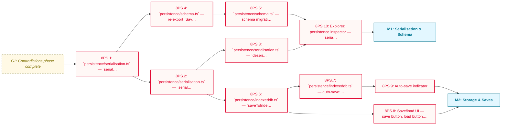

# Those Who Came Before: Persistence

**State:** planned. Stored as `archived` until the roadmap plugin gains a planned phase state
(goblin-scout 3.x); promote it once the phase before it is done. Index: [roadmaps](README.md).

**Gate G1:** Contradictions phase complete. Stands in for the cross-phase edge to Contradictions.
Lift it when this phase is promoted to active: remove G1 from each blocked task's dependsOn and mark
the gate done.

---

## Milestone 1: Serialisation & Schema

**Goal:** Game state round-trips through a versioned, migratable save format

- [ ] **8PS.1** — `persistence/serialisation.ts` — `serialiseMap` / `deserialiseMap` utilities for
      `Map<K,V>` → `[K,V][]` round-tripping _(blocked: depends on G1)_
- [ ] **8PS.2** — `persistence/serialisation.ts` — `serialiseGameState(state): SaveFile` — full
      state serialisation (worldState, playerInterpretation, termState; contradiction queue
      serialised within playerInterpretation; lensState recomputed on load, not persisted) _(blocked
      — depends on 8PS.1)_
- [ ] **8PS.3** — `persistence/serialisation.ts` — `deserialiseGameState(save): GameState` — full
      state deserialisation _(blocked — depends on 8PS.2)_
- [ ] **8PS.4** — `persistence/schema.ts` — re-export `SaveFile` and `CURRENT_SAVE_VERSION` from
      `src/lib/types/save.ts` (canonical home per 1FD.33); add save metadata shape _(blocked —
      depends on 8PS.1)_
- [ ] **8PS.5** — `persistence/schema.ts` — schema migration:
      `migrations: Record<number, Migration>`, `migrateSave(save): SaveFile` — sequential migration
      runner _(blocked — depends on 8PS.4)_
- [ ] **8PS.10** — Explorer: persistence inspector — serialised state size, schema version,
      round-trip diff, export raw JSON _(blocked — depends on 8PS.5, 8PS.3)_

---

## Milestone 2: Storage & Saves

**Goal:** IndexedDB storage, auto-save and save slots

- [ ] **8PS.6** — `persistence/indexeddb.ts` — `saveToIndexedDB(save)`,
      `loadFromIndexedDB(): SaveFile`, `listSaves()`, `deleteSave(id)` _(blocked — depends on
      8PS.2)_
- [ ] **8PS.7** — `persistence/indexeddb.ts` — auto-save: debounced 5-second write on significant
      player actions _(blocked — depends on 8PS.6)_
- [ ] **8PS.8** — Save/load UI — save button, load button, save slot list _(blocked — depends on
      8PS.6)_
- [ ] **8PS.9** — Auto-save indicator _(blocked — depends on 8PS.7)_

---

## Dependency Diagram

