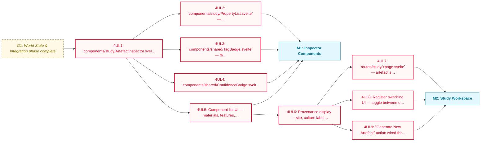

# Those Who Came Before: Player Interface

**State:** planned. Stored as `archived` until the roadmap plugin gains a planned phase state
(goblin-scout 3.x); promote it once the phase before it is done. Index: [roadmaps](README.md).

**Gate G1:** World State & Integration phase complete. Stands in for the cross-phase edge to World
State & Integration. Lift it when this phase is promoted to active: remove G1 from each blocked
task's dependsOn and mark the gate done.

---

## Milestone 1: Inspector Components

**Goal:** The artefact inspector and its building blocks: properties, tags, confidence, components

- [ ] **4UI.1** — `components/study/ArtefactInspector.svelte` — main artefact display shell
      (replaces `ItemGenerator.svelte`) _(blocked: depends on G1)_
- [ ] **4UI.2** — `components/study/PropertyList.svelte` — ordered list of artefact properties with
      register-specific descriptions _(blocked — depends on 4UI.1)_
- [ ] **4UI.3** — `components/shared/TagBadge.svelte` — tag display badge component _(blocked —
      depends on 4UI.1)_
- [ ] **4UI.4** — `components/shared/ConfidenceBadge.svelte` — confidence level badge _(blocked —
      depends on 4UI.1)_
- [ ] **4UI.5** — Component list UI — materials, features, decorative layers per component _(blocked
      — depends on 4UI.1)_

---

## Milestone 2: Study Workspace

**Goal:** A study route that generates an artefact and shows its provenance and registers

- [ ] **4UI.6** — Provenance display — site, culture label, period, context, dating framework from
      corpus _(blocked — depends on 4UI.5)_
- [ ] **4UI.7** — `routes/study/+page.svelte` — artefact study workspace: generates artefact,
      displays inspector _(blocked — depends on 4UI.6)_
- [ ] **4UI.8** — Register switching UI — toggle between observational, interpretive, technical
      descriptions _(blocked — depends on 4UI.6)_
- [ ] **4UI.9** — "Generate New Artefact" action wired through `gameState.surfaceArtefact()`
      _(blocked — depends on 4UI.6)_

---

## Dependency Diagram

