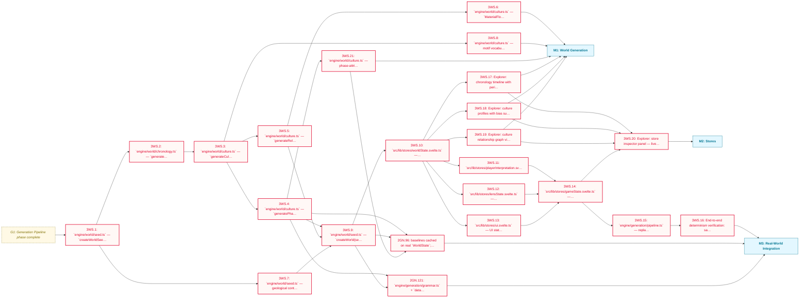

# Those Who Came Before: World State & Integration

**State:** planned. Stored as `archived` until the roadmap plugin gains a planned phase state
(goblin-scout 3.x); promote it once the phase before it is done. Index: [roadmaps](README.md).

**Gate G1:** Generation Pipeline phase complete. Stands in for the cross-phase edge to Generation
Pipeline. Lift it when this phase is promoted to active: remove G1 from each blocked task's
dependsOn and mark the gate done.

---

## Milestone 1: World Generation

**Goal:** A seed becomes a chronology, cultures with phases and relationships, material flows,
geology and motif vocabularies

- [ ] **3WS.1** — `engine/world/seed.ts` — `createWorldSeed(raw: string): WorldSeed` — seed string →
      PRNG _(blocked: depends on G1)_
- [ ] **3WS.2** — `engine/world/chronology.ts` — `generateChronology(seed, prng): WorldChronology` —
      startYear, endYear, presentYear, culture-relative periodisation (no shared timeline) _(blocked
      — depends on 3WS.1)_
- [ ] **3WS.3** — `engine/world/culture.ts` — `generateCultures(prng, count): Culture[]` — culture
      generation with `CulturalProfile` (materialAffinities, motifVocabulary, craftInvestment)
      _(blocked: depends on 3WS.2)_ — 2GN.110 edge added 2026-08-11: this task _generates_
      `materialAffinities`, so it cannot be written before that field's keyspace is settled —
      per-tag only, or per-material entries alongside (the expressive loss 2GN.78 accepted).
      Generating affinities in one shape and re-keying them later would mean regenerating every
      seeded world. 2GN.123 edge added 2026-08-13: 2GN.110 ruled the keyspace, 2GN.123 shipped it as
      `readonly MaterialAffinity[]` resolved most-specific-wins, and it is the shipped shape this
      task has to generate against. Both are `done`, so the edge changes no scheduling; it records
      which task the dependency actually rests on
- [ ] **3WS.4** — `engine/world/culture.ts` — `generatePhases(culture, prng): CulturePhase[]` — 3-4
      phases per culture with `PhaseCharacteristics` (technology, economy, society, aesthetics)
      _(blocked — depends on 3WS.3)_
- [ ] **3WS.5** — `engine/world/culture.ts` —
      `generateRelationships(cultures, prng): CultureRelationship[]` — temporal relationship phases
      with trade, conflict, cultural exchange, politics _(blocked — depends on 3WS.3)_
- [ ] **3WS.6** — `engine/world/culture.ts` — `MaterialFlow` generation within relationships (tag,
      materials, direction, volume) _(blocked: depends on 3WS.5)_ — 2GN.126 edge added 2026-08-13: a
      found/produced split changes what a flow can coherently carry, since ore, ingots and finished
      hide are different goods
- [ ] **3WS.7** — `engine/world/seed.ts` — geological context generation: `GeologicalContext` with
      material availability per region, `AvailabilityLevel` per material _(blocked: depends on
      3WS.1)_ — 2GN.126 edge added 2026-08-13: this task _generates_ `AvailabilityLevel`, so
      generating against a model known to conflate found and produced materials would bake the
      conflation into the generator. — inherits the region-vocabulary decision dependency sweep
      2026-07-25 deferred here: decide whether regions become first-class (`Culture` gains a region
      binding, ⚠️ breaking) or stay convention-agreed strings, and reconcile the provisional region
      strings 2GN.26 and 2GN.47 already mint against mock fixtures. That decision is now ruled by
      2GN.142 (2026-08-24), with implementation filed as 2GN.144 (2026-08-25): region is
      world-level, referenced by `CulturePhase.geography.regions: string[]` — this task generates
      the real `GeologicalContext`/regions for production cultures and needs that field to exist
      before it can populate it
- [ ] **3WS.8** — `engine/world/culture.ts` — motif vocabulary generation per culture (distinctive
      sets for cultural fingerprinting) _(blocked — depends on 3WS.3)_ — generated vocabularies must
      be non-empty: doc 05 §8.5 treats motifs as the primary cultural fingerprint and doc 06's
      decorative-mismatch strain assumes motif attribution works for every culture;
      `assignDecorativeDetails` (2GN.33) deliberately degrades gracefully on an empty vocabulary
      rather than enforcing this, so enforcement lives here (recorded 2026-07-25)
- [ ] **3WS.9** — `engine/world/seed.ts` — `createWorld(seed: string): WorldState` — full
      orchestrator: chronology + cultures + geology + relationships _(blocked — depends on 3WS.4,
      3WS.7, 3WS.5)_
- [ ] **3WS.17** — Explorer: chronology timeline with period boundaries _(blocked — depends on
      3WS.10)_
- [ ] **3WS.18** — Explorer: culture profiles with bias summaries _(blocked — depends on 3WS.10)_
- [ ] **3WS.19** — Explorer: culture relationship graph visualisation _(blocked — depends on
      3WS.10)_
- [ ] **3WS.21** — `engine/world/culture.ts` — phase-attribute continuity: `generatePhases` must
      evolve `PhaseCharacteristics` continuously between adjacent phases, with bounded per-phase
      change and sharp breaks as deliberate rare events rather than the default _(blocked — depends
      on 3WS.4)_ — surfaced 2026-08-04 by the 2GN.80/2GN.77 ruling (doc 11 §2.9, doc 12 §2.28),
      which records status-tag drift per culture-phase against the immediately preceding phase. That
      measure is only meaningful if phases evolve continuously, and nothing enforces it:
      `CulturePhase.characteristics` is a free `PhaseCharacteristics` per phase, and doc 05's five
      coherence rules are all within-artefact (structural, geological, decorative), none temporal.
      As specified, a culture could oscillate `decorativeEmphasis` 0.1 → 1.0 → 0.1 across three
      phases unchallenged, and drift measured across those phases would report noise. Recorded by
      the decision that depends on it rather than discovered later

---

## Milestone 2: Stores

**Goal:** Svelte 5 stores wrap world state, the player model, lens and UI state under one
orchestrator

- [ ] **3WS.10** — `src/lib/stores/worldState.svelte.ts` — reactive wrapper: chronology, artefacts,
      sites, scholars, documents, lineage graph, venues, career events _(blocked — depends on
      3WS.9)_
- [ ] **3WS.11** — `src/lib/stores/playerInterpretation.svelte.ts` — reactive wrapper around
      player's `InterpretiveModel` with immutable update methods (placeholder) _(blocked — depends
      on 3WS.10)_
- [ ] **3WS.12** — `src/lib/stores/lensState.svelte.ts` — lens state store (placeholder, computed
      later) _(blocked — depends on 3WS.10)_
- [ ] **3WS.13** — `src/lib/stores/ui.svelte.ts` — UI state: selected artefact, active panel
      _(blocked — depends on 3WS.10)_
- [ ] **3WS.14** — `src/lib/stores/gameState.svelte.ts` — orchestrator: imports all stores, provides
      `initialise(seed)`, `surfaceArtefact()`, `refreshLens()`, cross-store coordination _(blocked —
      depends on 3WS.12, 3WS.10, 3WS.11, 3WS.13)_
- [ ] **3WS.20** — Explorer: store inspector panel — live view of `worldState`,
      `playerInterpretation` contents (`termState` added at 9CR.21) _(blocked — depends on 3WS.14,
      3WS.19, 3WS.18, 3WS.17)_

---

## Milestone 3: Real-World Integration

**Goal:** The generation pipeline reads real WorldState instead of mock fixtures, deterministically

- [ ] **3WS.15** — `engine/generation/pipeline.ts` — replace mock culture profiles with real
      `WorldState` data throughout _(blocked — depends on 3WS.14)_
- [ ] **3WS.16** — End-to-end determinism verification: same seed + same position → identical
      artefacts _(blocked — depends on 3WS.15)_
- [ ] **2GN.96** — baselines cached on real `WorldState`; drift-vs-preceding-phase;
      `PhaseCharacteristics.society.stratification` as a live classification input _(blocked:
      depends on 3WS.4, 3WS.9, 3WS.21)_ — split out of 2GN.95's scope 2026-08-05: doc 11 §2.9 says
      baselines are "cached in world state", but `WorldState` does not exist (`types/
      save.ts`
      — lands at 3WS.9). Drift-vs-preceding-phase needs a real multi-phase timeline; every fixture
      today is single-phase, and 3WS.21 (phase-attribute continuity) is doc 11 §2.9's own named
      prerequisite for that measurement to mean anything rather than measure noise across incoherent
      phases. `stratification` is ruled a live input gating how much `elite` can exist at all,
      independent of any one distribution — deliberately absent from `ClassificationContext` until
      this task, since declaring it unread would be a lie the type tells. Moved from M2 to M3
      2026-08-05: its dependencies are all M3 tasks, and M3's own entry point (3WS.1) gates on the
      whole of M2 completing — an M2 task cannot depend on M3 work without a cycle
  - Note: **Re-scoped 2026-09-15 by 2GN.27** (doc 11 §2.9, doc 12 §2.59): the stratification gate
    covers the decoration-side `elite` awards only. Material-side `elite` needs none: stratification
    enters at stage 6 as `assignMaterials`' stratum draw, and the material-standing rule's realised
    rate already tracks it (12% at 0.4, 35% at 0.85). Extending that stratum to the decoration
    budget, so a stratified culture's elite artefacts are also the lavish ones, is the natural shape
    for this task's gate.
  - Note: **Re-scoped again 2026-11-18 by 2GN.164:** the decoration-side `elite` gate is superseded.
    Social `elite` is read from the stratum (2GN.165, 2GN.166) and the percentile decoration rules
    award `lavish`, which needs no stratification gate. Remaining scope: baselines on `WorldState`
    and drift-vs-preceding-phase. The generator-side idea of a stratum-driven decoration budget is
    2GN.169, which this task now waits on (2GN.169 edge added).
- [ ] **2GN.121** — `engine/generation/grammar.ts` + `data/grammars/primitives.ts` — weight the
      `base` parameter roll per culture rather than rolling uniformly over a shared vocabulary
      _(blocked: depends on 3WS.4, 3WS.9)_ — 2GN.118 ruled (2026-08-13) that `cylindrical` and
      `hollow-enclosed` both roll the full `['flat','rounded','pointed','pedestal']` union, with the
      extractor's primitive-type branch in `classification.ts` kept as a marked seam rather than
      collapsed, precisely so per-primitive divergence can return as **weights** once something
      rules what drives them. The uniform roll is the placeholder: a pedestalled cylinder is now
      reachable but exactly as likely as a flat one, in every culture, which is the same
      absolute-table defect as 2GN.86/87/108/120 in a different guise. `aesthetics.formConservatism`
      (`types/world.ts`) is already specified as narrowing grammar branch variance and is unread by
      `expandGrammar` today; `society.stratification` is the plausible driver for pedestal
      frequency, a display foot being a stratification signal. Rule the input set and the weighting
      shape, then thread it through `expandGrammar`'s determinism-critical draw sequence. ⚠️ moves
      `base-pedestal-display` and `base-pointed-amphora` fire rates, so `EXPECTED_FIRE_RATES` needs
      re-recording with the drift annotated. Placed in M3 on the 2GN.96 precedent — a generation
      task parked with the world-state data it reads; depends on 3WS.9 rather than 3WS.4 alone so
      the weighting waits for the full `createWorld` orchestrator

---

## Dependency Diagram

